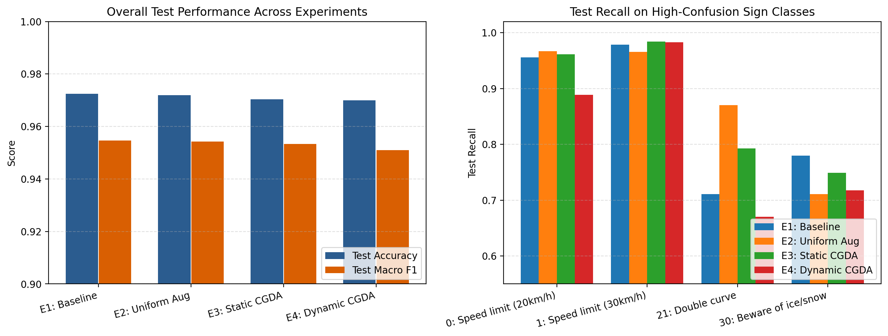

# GTSRB Confusion-Guided Data Augmentation (CGDA)

## 1. Project Overview & Current Status

This repository implements **Confusion-Guided Data Augmentation (CGDA)** on the German Traffic Sign Recognition Benchmark (GTSRB, 43 traffic sign classes) using a ResNet18 classifier. The study investigates whether targeting augmentation toward poorly classified traffic sign classes improves classification performance compared to conventional augmentation strategies.

### Completed Implementation and Experiments

* **Dataset & Track-Aware Split (`data_utils/gtsrb.py`, `results/split_seed42.json`):** An 80/20 train/validation split grouped by physical sign track, designed to prevent track leakage between training and validation.
* **Experiment E1 — Baseline (`training/train_baseline.py`):** Baseline model trained across three seeds, achieving **97.24% ± 0.11%** test accuracy and **95.46% ± 0.24%** test macro F1.
* **Experiment E2 — Budget-Matched Uniform Augmentation (`training/train_uniform.py`):** Uniform augmentation control using the weighted-average augmentation probability derived from static CGDA.
* **Experiment E3 — Static CGDA (`training/train_static_cgda.py`):** Class-specific augmentation probabilities derived from E1 validation confusion analysis and kept fixed throughout training.
* **Experiment E4 — Dynamic CGDA (`training/train_dynamic_cgda.py`):** Adaptive class-specific augmentation probabilities recalculated every five epochs based on validation performance.
* **Evaluation (`evaluation/analyze_confusion.py`, `evaluation/compare_experiments.py`):** Completed confusion analyses, per-class recall analyses, aggregate performance metrics, and comparative visualizations across all four experiments.

All four experiments have been completed across three random seeds (`42`, `123`, and `2026`), totaling **12 training runs**.

### Experimental Outputs

All generated experimental results are available in the repository:

| Directory / File | Description |
| --- | --- |
| `results/metrics/` | Individual training and evaluation metrics across all experiments and seeds |
| `results/analysis/` | Confusion analyses and aggregated experimental results |
| `results/figures/` | Confusion matrices, per-class recall plots, and comparative visualizations |
| `results/analysis/final_comparison.json` | Consolidated performance comparison across E1–E4 |
| `results/figures/E1_to_E4_comparison.png` | Visual comparison of experimental performance |
| `results/split_seed42.json` | Shared training-validation split |

Model checkpoints are stored separately in Google Drive and are not included in the GitHub repository.


### Experimental Results Summary

The following results are reported as mean ± standard deviation (%) across three random seeds (`42`, `123`, and `2026`).

| Experiment | Validation Accuracy (%) | Validation Macro F1 (%) | Test Accuracy (%) | Test Macro F1 (%) |
| --- | ---: | ---: | ---: | ---: |
| E1 — Baseline | **98.20 ± 0.12** | **97.57 ± 0.10** | **97.24 ± 0.11** | **95.46 ± 0.24** |
| E2 — Uniform Augmentation | 97.39 ± 0.45 | 95.86 ± 0.53 | 97.20 ± 0.07 | 95.42 ± 0.20 |
| E3 — Static CGDA | 97.84 ± 0.33 | 96.21 ± 1.22 | 97.03 ± 0.37 | 95.34 ± 0.76 |
| E4 — Dynamic CGDA | 97.77 ± 0.39 | 96.87 ± 0.82 | 97.00 ± 0.27 | 95.09 ± 0.30 |

**Bold values** indicate the highest mean performance for each metric.



The baseline achieved the highest mean aggregate performance across all four metrics. Further class-level analysis is conducted to investigate potential localized benefits and performance trade-offs associated with CGDA.

The consolidated numerical results are available in [`final_comparison.json`](results/analysis/final_comparison.json).


### Additional Class-Level Analyses

Beyond aggregate accuracy and macro F1, supplementary class-level analyses have been generated to investigate the effects of CGDA on individual traffic sign classes and frequently confused class pairs.

These analyses include:

1. **Underperforming Classes:** Comparative test recall of the 10 lowest-recall classes identified from baseline validation results.
2. **Confusion Pair Analysis:** Comparison of test misclassification rates for frequently confused class pairs identified from baseline validation results.
3. **Speed-Limit Recognition:** Comparison of per-class recall and within-group misclassification rates among speed-limit signs.
4. **Class-Level Performance Trade-offs:** Assessment of recall changes across all 43 classes, including initially weak and strong classes.
5. **Improvement and Seed Consistency:** Quantification of improved, near-unchanged, and declined classes, including consistency across the three random seeds.

#### Generated Analytical Tables

| File | Description |
| --- | --- |
| `baseline_worst_classes.csv` | Test recall of baseline-defined underperforming classes |
| `confusion_pairs.csv` | Comparative misclassification rates |
| `speed_limit_recall.csv` | Per-class recall of speed-limit signs |
| `speed_limit_confusion.csv` | Within-speed-limit misclassification rates |
| `all_class_recall_changes.csv` | Recall changes across all 43 classes |
| `recall_by_class_group.csv` | Comparative recall of initially weak, middle, and strong classes |
| `improvement_summary.csv` | Summary of improved, near-unchanged, and declined classes |
| `seed_level_consistency.csv` | Class-level recall changes across individual seeds |
| `consistent_improvements.csv` | Classes consistently improved across all three seeds |
| `test_recall_std.csv` | Per-class test recall variability |

All supplementary tables are available in [`results/analysis/class_comparison/`](results/analysis/class_comparison/).

#### Generated Comparative Figures

* [Recall of Baseline's Worst-Performing Classes](results/figures/comparison_baseline_worst_classes.png)
* [Confusion Pair Comparison](results/figures/comparison_confusion_pairs.png)
* [Speed-Limit Recall Comparison](results/figures/comparison_speed_limits.png)
* [Class-Level Recall Changes](results/figures/comparison_class_recall_changes.png)

These analyses were generated using existing experimental outputs without additional model training.

**Current Status:** Supplementary analytical tables and visualizations have been generated. Validation, interpretation, and discussion of the class-level findings are ongoing.


### Current Progress

- [x] Dataset preparation and preprocessing
- [x] Track-aware splitting
- [x] Baseline model implementation
- [x] Static and dynamic CGDA implementation
- [x] E1 — Baseline training
- [x] E2 — Budget-matched uniform augmentation training
- [x] E3 — Static CGDA training
- [x] E4 — Dynamic CGDA training
- [x] Confusion and per-class recall analyses
- [x] Aggregate comparative evaluation and visualization
- [x] Baseline-defined underperforming class analysis
- [x] Comparative confusion pair analysis
- [x] Speed-limit recognition analysis
- [x] Class-level performance trade-off analysis
- [x] Multi-seed class-level consistency analysis
- [x] Upload experimental results to GitHub
- [ ] Final validation of experimental and analytical outputs
- [ ] Interpretation and discussion of findings
- [ ] Research paper completion
- [ ] Research presentation


### Experimental Notebook

The Google Colab notebook used for model training, comparative evaluation, and supplementary class-level analyses is available below:

[Google Colab — GTSRB CGDA Experiments](https://colab.research.google.com/drive/1wn-GS6fU1qWT7NIuk98j2NiGnW3bTB77?usp=sharing)

The notebook documents the experimental execution and additional analytical procedures used in this study.


### Reproducing the Experiments

The following sections provide step-by-step instructions for reproducing the experiments using Google Colab, including:

1. Setting up repository access and the computational environment.
2. Running Experiments E3, E2, and E4 across all three seeds.
3. Generating evaluation metrics, confusion analyses, and comparative visualizations.
4. Exporting experimental results or pushing them directly to GitHub.

These instructions are retained for reproducibility and future experimentation. Retraining is not required to access or analyze the existing experimental results.

---

## 2. Phase 1: Accept the GitHub Collaborator Invite

1. Open your email inbox (the email linked to your GitHub account) and look for an invitation email from GitHub for **`lizzzie917/gtsrb-cgda`**.
   * *Alternative:* Sign in to GitHub in your browser and visit `https://github.com/lizzzie917/gtsrb-cgda/invitations`.
2. Click **Accept invitation**.
3. Confirm you can view the repository homepage at `https://github.com/lizzzie917/gtsrb-cgda`.

---

## 3. Phase 2: Open Google Colab & Enable GPU

1. Open a web browser (Chrome or Edge recommended) and go to `https://colab.research.google.com`.
2. Sign in with your Google account (make sure you have at least 2 GB of free space on Google Drive for model checkpoints and datasets).
3. In the pop-up window, click **+ New notebook** at the bottom (or click **File -> New notebook in Drive** in the top-left menu).
4. Optional: Click the notebook title at the top left (e.g., `Untitled0.ipynb`) and rename it to `GTSRB_CGDA_Experiments.ipynb`.
5. Turn on the GPU:
   * Click **Runtime** in the top menu bar.
   * Click **Change runtime type**.
   * Under **Hardware accelerator**, select **T4 GPU**.
   * Click **Save**.
6. Wait a few seconds until the top-right corner displays a green checkmark next to **RAM / Disk** (this confirms your GPU machine is connected).

---

## 4. Phase 3: Run Experiments E3, E2, and E4 in Google Colab

### How to Use Colab Cells
* To add a new code block, hover near the bottom center of the current cell and click **+ Code** (or click **+ Code** in the top-left toolbar).
* Paste the exact code from one cell below into the Colab code box.
* Click the **Play button** (circle with a triangle) on the left side of the cell, or press **`Shift + Enter`**.
* **Wait for the cell to finish completely** (the spinning circle around the Play button will stop and turn into a green checkmark) before running the next cell.

---

### Cell 1: Mount Google Drive & Clone the Repository
> **What this does:** Connects your Google Drive so results are backed up automatically, downloads the project code from GitHub, and downloads/prepares folders. When prompted by a pop-up window, click **Connect to Google Drive**, choose your Google account, and click **Allow**.

```python
from google.colab import drive
drive.mount('/content/drive')

# Clone the repository using a plain URL
!git clone https://github.com/lizzzie917/gtsrb-cgda.git

# Enter the repository
%cd /content/gtsrb-cgda

# Create backup directories in Google Drive
import os

os.makedirs('/content/drive/MyDrive/gtsrb-cgda/checkpoints', exist_ok=True)
os.makedirs('/content/drive/MyDrive/gtsrb-cgda/results', exist_ok=True)

# Link checkpoints to Google Drive
if os.path.islink('checkpoints') or os.path.exists('checkpoints'):
    os.remove('checkpoints')

os.symlink(
    '/content/drive/MyDrive/gtsrb-cgda/checkpoints',
    'checkpoints'
)

# Verify repository location
print("Current directory:", os.getcwd())
print("Training folder exists:", os.path.isdir('training'))
print("Results folder exists:", os.path.isdir('results'))
```

---
### Cell 2, 3, 4: Install dependencies
> **Before training, run this in a separate cell:**

```
!pip install -r requirements.txt
```

> **verify that Colab recognizes your GPU:**

```
import torch

print("PyTorch version:", torch.__version__)
print("GPU available:", torch.cuda.is_available())

if torch.cuda.is_available():
    print("GPU:", torch.cuda.get_device_name(0))
```

> **verify that the training scripts are accessible:**

```
!ls training/
!ls results/metrics/
!ls results/analysis/
```

---

### Cell 5, 6: Run Experiment E3 (Static CGDA — 3 Seeds)
> **What this does:** Downloads the GTSRB dataset on the first seed, trains Static CGDA for 25 epochs across seeds `42`, `123`, and `2026`, and backs up `results/` to your Google Drive. (Run time: 35 minutes. ~10mins each seed).*

```python
!python -m training.train_static_cgda --seed 42
!python -m training.train_static_cgda --seed 123
!python -m training.train_static_cgda --seed 2026
!cp -r results/* /content/drive/MyDrive/gtsrb-cgda/results/
```

> **One important precaution:** You can run all three seeds in one cell but if you want, you can also run them in separate cells. Just don't run them all in separate Colab cells simultaneously. Run them SEQUENTIALLY so that GPU memory and experiment outputs are managed properly. 

> **verify its output:** 

```python
 !ls results/metrics/E3*
```

---

### Cell 6: Run Experiment E2 (Budget-Matched Uniform Augmentation — 3 Seeds)
> **What this does:** Trains the uniform augmentation control across seeds `42`, `123`, and `2026`, then backs up `results/` to your Google Drive. *(Estimated time: 10 to 15 minutes each seed).*

```python
!python -m training.train_uniform --seed 42
!python -m training.train_uniform --seed 123
!python -m training.train_uniform --seed 2026
!cp -r results/* /content/drive/MyDrive/gtsrb-cgda/results/
```
> **verify its output:** 

```python
 !ls results/metrics/E2*
```
---

### Cell 7: Run Experiment E4 (Dynamic CGDA — 3 Seeds)
> **What this does:** Trains Dynamic CGDA (updating per-class augmentation probabilities every 5 epochs) across seeds `42`, `123`, and `2026`, then backs up `results/` to your Google Drive. *(Estimated time: 10 to 15 minutes each seed).*

```python
!python -m training.train_dynamic_cgda --seed 42
!python -m training.train_dynamic_cgda --seed 123
!python -m training.train_dynamic_cgda --seed 2026
!cp -r results/* /content/drive/MyDrive/gtsrb-cgda/results/
```

> **Tip if Colab disconnects mid-way:** Keep the Colab browser tab open while training runs. If Colab ever disconnects or restarts, re-run **Cell 1**, restore any already-finished results from Drive by running `!cp -r /content/drive/MyDrive/gtsrb-cgda/results/* results/`, and then continue from whichever experiment cell did not finish.

> **verify its output:** 

```python
 !ls results/metrics/E4*
```
---

## 5. Phase 4: Generate Confusion Analyses, Charts & Download Results

### Cell 5: Generate All Summary Tables, Confusion Matrices & Comparison Plots
> **What this does:** Evaluates all 3 seeds for `E2_uniform`, `E3_static_cgda`, and `E4_dynamic_cgda`, creates the side-by-side comparison table and figure across `E1` through `E4`, and backs everything up to Google Drive. *(Estimated time: under 15 seconds).*

```python
!python -m evaluation.analyze_confusion --exp E2_uniform
!python -m evaluation.analyze_confusion --exp E3_static_cgda
!python -m evaluation.analyze_confusion --exp E4_dynamic_cgda
!python -m evaluation.compare_experiments
!cp -r results/* /content/drive/MyDrive/gtsrb-cgda/results/
```

---

### Cell 6: Zip & Download `results_all.zip` to Your Computer
> **What this does:** Packages the entire `results/` folder into `results_all.zip` and triggers a browser download to your computer's **Downloads** folder.

```python
!zip -r /content/results_all.zip results/
from google.colab import files
files.download('/content/results_all.zip')
```

*(If your browser blocks the automatic download, click the **Folder icon** on the far-left sidebar of Colab, click the `..` parent folder icon to go to `/content/`, find `results_all.zip`, click the three dots next to it, and click **Download**).*

---

### If you don't want to Download `results_all.zip` to Your Computer, you can just Commit Changes directly to Github
> **Follow Phase 5.2 Instructions**.


## 6. Phase 5.1: Upload the Results Back to GitHub (Local Computer Ver)

### Step 1: Clone the Repository to Your Computer
1. Open a terminal on your computer:
   * **Windows:** Press the **Windows key**, type `PowerShell` or `Git Bash`, and press **Enter**.
   * **Mac:** Press **`Cmd + Space`**, type `Terminal`, and press **Enter**.
2. Navigate to where you want to store the project (for example, your `Documents` folder) and clone the repository:
   ```bash
   cd ~/Documents
   git clone https://github.com/lizzzie917/gtsrb-cgda.git
   cd gtsrb-cgda
   git checkout -b feature/cgda-results
   ```

### Step 2: Extract `results_all.zip` into Your Local `gtsrb-cgda/results/` Folder
1. Open your computer's file manager (**File Explorer** on Windows or **Finder** on Mac) and open your **Downloads** folder.
2. Right-click **`results_all.zip`** and extract/unzip it:
   * **Windows:** Right-click `results_all.zip` -> **Extract All...** -> **Extract**.
   * **Mac:** Double-click `results_all.zip`.
3. Open the extracted folder until you see the **`results`** folder containing three subfolders: `analysis`, `figures`, and `metrics`.
4. Copy those three folders (`analysis`, `figures`, and `metrics`) and paste them into your cloned repository's **`Documents/gtsrb-cgda/results/`** folder.
   * When asked if you want to merge or replace existing files, click **Replace / Merge**.
   * **Important:** Do **not** delete `results/split_seed42.json` or any `E1_baseline` files already inside `results/`.

### Step 3: Push Your Results Branch & Open a Pull Request
1. Return to your terminal inside the `gtsrb-cgda` folder and run:
   ```bash
   git status
   git add results/
   git commit -m "Add E2, E3, and E4 metrics, confusion analyses, and figures"
   git push -u origin feature/cgda-results
   ```
2. Open `https://github.com/lizzzie917/gtsrb-cgda` in your web browser.
3. Click the green **Compare & pull request** button that appears near the top of the page.
4. Click **Create pull request**, then click **Merge pull request** -> **Confirm merge** to merge your results into `main`.


## 7. Phase 5.2: Upload the Results Directly to GitHub (Colab Ver)

This method allows you to commit and push experimental
results directly from Google Colab without downloading
`results_all.zip` to your computer.

### Step 1: Configure your Git identity

Run this once:

```python
!git config --global user.name "Your Full Name"
!git config --global user.email "your-github-email@example.com"
```

Use the name and email associated with your GitHub account.

### Step 2: Check which files have changed

```python
!git status
```

You should see your newly generated experiment results
listed as untracked or modified files.

### Step 3: Stage your results

```python
!git add results/
```

**Important:** Do not use `git add .` or
`git add checkpoints/`. The checkpoints directory is a
symbolic link to Google Drive and should remain untracked.

Verify the staged files:

```python
!git status
!git diff --cached --stat
```

### Step 4: Commit the changes

```python
!git commit -m "Add E2 E3 and E4 experimental results"
```

### Step 5: Generate a GitHub Personal Access Token (PAT)

GitHub requires authentication when pushing from Colab.

1. Go to https://github.com/settings/tokens.
2. Click **Generate new token (classic)**.
3. Configure the following:
   - **Note:** GTSRB Colab
   - **Expiration:** 30 days
   - **Scope:** `repo` (leave other scopes unchecked)
4. Click **Generate token**.
5. Copy the generated token and keep it private.

Ensure you have accepted the GitHub collaborator invitation
before proceeding.

### Step 6: Authenticate and push to GitHub

Check your current branch:

```python
!git branch --show-current
```

If your branch is `main` and direct pushes are permitted,
run the following cell:

```python
from getpass import getpass
import subprocess
import os
import base64

username = input("GitHub username: ")
token = getpass("GitHub Personal Access Token: ")

credentials = base64.b64encode(
    f"{username}:{token}".encode()
).decode()

env = os.environ.copy()
env["GIT_CONFIG_COUNT"] = "1"
env["GIT_CONFIG_KEY_0"] = "http.extraHeader"
env["GIT_CONFIG_VALUE_0"] = f"Authorization: Basic {credentials}"
env["GIT_TERMINAL_PROMPT"] = "0"

result = subprocess.run(
    ["git", "push", "origin", "main"],
    capture_output=True,
    text=True,
    env=env
)

print(result.stdout)
print(result.stderr)
print("Exit code:", result.returncode)

del token, credentials, env
```

Run the code as provided. Enter your GitHub username
(not your display name) and PAT when prompted.

An exit code of `0` indicates a successful push.

**Security:** Never hardcode your PAT into the notebook
or share it with other users.

### Step 7 (Optional): Resolve a "fetch first" error

If the push is rejected because the remote repository
contains newer changes, create a backup branch first:

```python
!git branch backup-experiment-results
```

Copy the authentication cell from Step 6 into a new cell,
then replace:

```python
["git", "push", "origin", "main"],
```

with:

```python
["git", "pull", "--rebase", "origin", "main"],
```

Run the modified cell and authenticate again.

If the pull succeeds (exit code `0`), rerun the original
authentication and push cell from Step 6.

If a conflict occurs, resolve it before pushing.
Do not use `git push --force`.

### Step 8: Verify successful submission

```python
!git status
!git log -1 --oneline
```

The expected status is:

```
On branch main
Your branch is up to date with 'origin/main'.

Untracked files:
    checkpoints
```

The untracked checkpoints entry is expected and can be
left unchanged.

Visit https://github.com/lizzzie917/gtsrb-cgda
to confirm that all experimental results have been uploaded.

Once the submission is complete, you may revoke your PAT
at https://github.com/settings/tokens.
